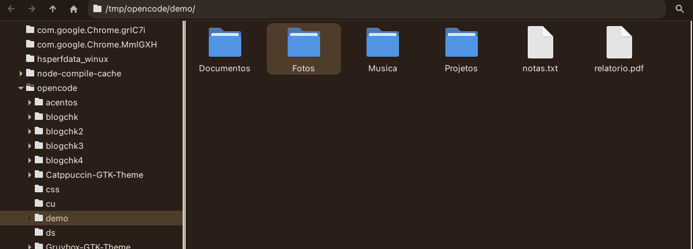
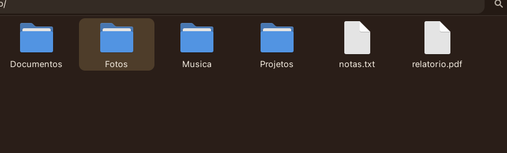

# ☕ Coffee — GTK theme

A warm **coffee/espresso** GTK theme for XFCE (and GNOME/GTK desktops), with:

- Espresso-dark windows (`#241A14`) and matching titlebars/panel
- Selection color exactly matching the **OpenCode `cafe` theme** input box (`#4E3D2A`)
- Caramel accent (`#E0A86A`)
- Light **Latte** variant included
- Matching **xfwm4** (window manager) assets recoloured to coffee

Derived from [Gruvbox-GTK-Theme](https://github.com/Fausto-Korpsvart/Gruvbox-GTK-Theme) by Fausto-Korpsvart (GPLv3), recoloured with a custom coffee palette.




---

## 🎨 Palette

| Token | Color | Use |
|---|---|---|
| `#F7EFE3` | cream | text / light surfaces |
| `#E0A86A` | caramel | accent |
| `#E3D2BD` | latte | selection text |
| `#4E3D2A` | mocha | **selection background** |
| `#2A1E18` | coffee | highlights / titlebar |
| `#241A14` | espresso | window background |

## 📦 Installation

```bash
git clone https://github.com/RicSchonfelder/coffee-gtk-theme.git
cd coffee-gtk-theme
./install.sh
```

The installer copies the themes to `~/.themes/` and (on XFCE) applies them.

Then pick **Coffee-Dark** or **Coffee-Light** in:

- *Settings → Appearance → Style*
- *Settings → Window Manager → Style*
- *Settings → Appearance → Icons* (use Papirus / Papirus-Dark)

## 🔧 Manual install

```bash
cp -r themes/Coffee-* ~/.themes/

# XFCE
xfconf-query -c xsettings -p /Net/ThemeName   -s "Coffee-Dark"
xfconf-query -c xfwm4     -p /general/theme   -s "Coffee-Dark"
xfconf-query -c xsettings -p /Net/IconThemeName -s "Papirus-Dark"
```

To refresh the window manager / panel after switching:

```bash
xfwm4 --replace &
xfce4-panel -r &
```

## 🛠️ Rebuilding from source

The `src/` folder holds the modified Sass sources from the upstream theme.
The build clones upstream, overlays these files, builds, and recolours the
xfwm4 assets:

```bash
./build.sh          # requires: git, sassc
```

## 📁 Layout

```
coffee-gtk-theme/
├── themes/          # ready-to-use built themes (Coffee-Dark / Light, +hdpi)
├── src/             # modified upstream Sass (palette + selection overrides)
├── tools/
│   └── recolor-xfwm.sh   # recolours xfwm4 PNG assets (grey -> coffee)
├── screenshots/
├── install.sh
└── build.sh
```

## 📜 License

GPLv3 — see [LICENSE](LICENSE).
Original theme © Fausto-Korpsvart; coffee palette & selection tweaks © RicSchonfelder.
